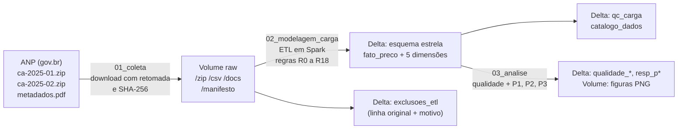
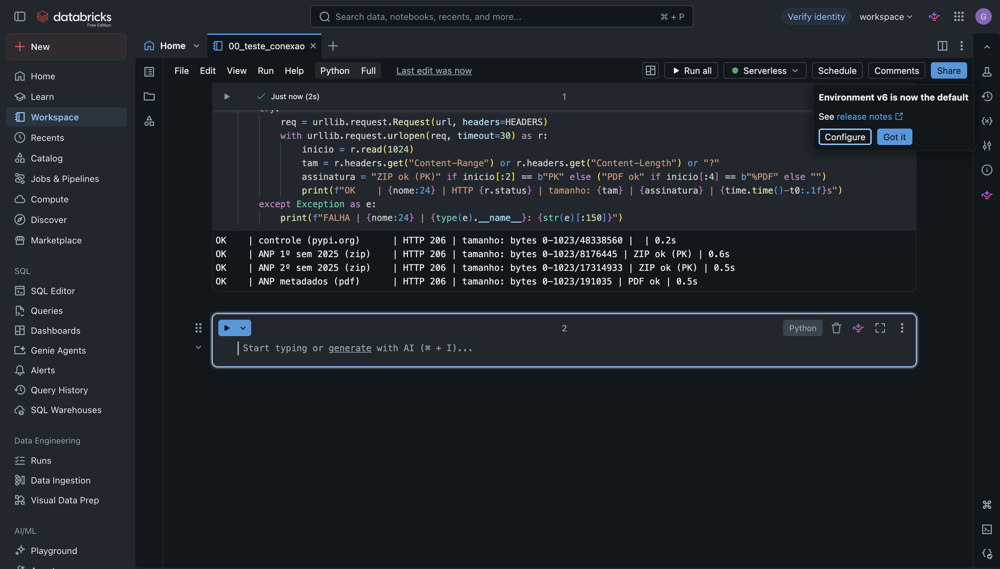
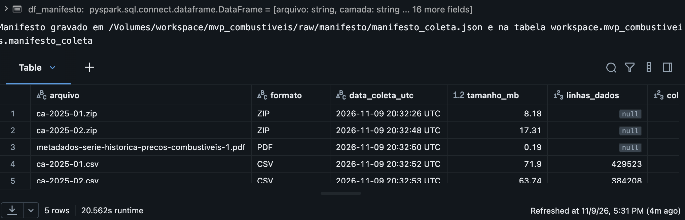
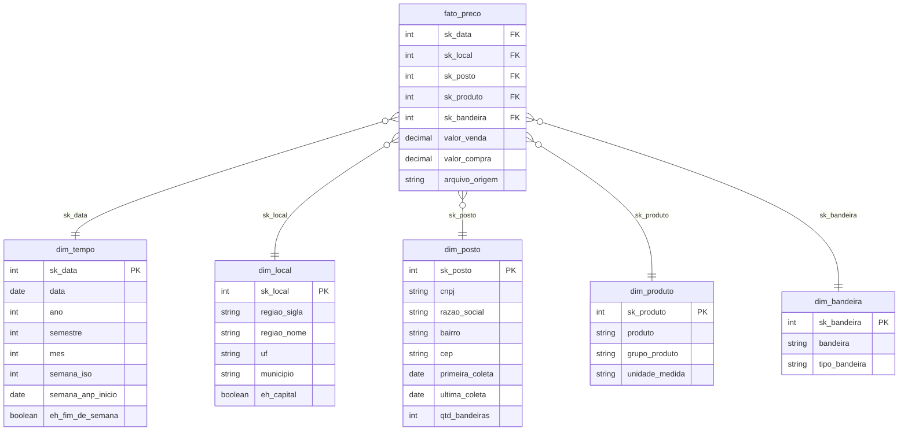

# Preços de combustíveis no Brasil (ANP, 2025): pipeline de dados em nuvem para apoiar a decisão "etanol ou gasolina?" e "vale a pena pesquisar posto?"

| | |
|---|---|
| **Instituição** | Universidade de Brasília (UnB), Departamento de Engenharia de Produção |
| **Disciplina** | Sistemas de Suporte à Decisão (SSD) |
| **Professor** | André Luiz Marques Serrano |
| **Autor** | Gabriel Noleto (matrícula 211068010) |
| **Plataforma** | Databricks Free Edition (computação serverless, Unity Catalog, Delta Lake) |
| **Fonte dos dados** | ANP, Série Histórica de Preços de Combustíveis (2025) |

## Índice

1. [Objetivo](#1-objetivo)
2. [Arquitetura do pipeline](#2-arquitetura-do-pipeline)
3. [Como reproduzir](#3-como-reproduzir)
4. [Busca e coleta](#4-busca-e-coleta)
5. [Modelagem](#5-modelagem)
6. [Carga e validações](#6-carga-e-validações)
7. [Análise](#7-análise)
8. [Autoavaliação](#8-autoavaliação)
9. [Ética, licença dos dados e LGPD](#9-ética-licença-dos-dados-e-lgpd)
10. [Referências](#10-referências)

---

## 1. Objetivo

> Esta seção foi escrita **antes** de olhar os dados e permanece inalterada, como pede o enunciado. O atingimento de cada pergunta é discutido na [Autoavaliação](#8-autoavaliação).

**Problema.** O combustível pesa no orçamento de quem dirige, mas o motorista decide sem informação: não sabe se o etanol compensa na sua região nem quanto o preço varia entre postos da mesma cidade.

**Funcionalidade principal do MVP.** Um conjunto de indicadores, calculados a partir da pesquisa oficial de preços da ANP, que responde a duas perguntas práticas: "etanol ou gasolina?" e "vale a pena pesquisar posto?".

**Recorte.** Combustíveis automotivos, ano de 2025 (dois arquivos semestrais), todo o Brasil, com destaque para Brasília.

**Perguntas, hipóteses e métricas**

| | Pergunta | Hipótese | Métrica e critério |
|---|---|---|---|
| P1 | Em quais UFs, e em quantas semanas de 2025, o etanol compensou frente à gasolina comum? | O etanol compensa em poucas UFs, concentradas em regiões produtoras. | Razão entre as medianas semanais de preço do etanol e da gasolina, por UF. Compensa se a razão for ≤ 0,70, a regra usual de rendimento. A hipótese se confirma se menos da metade das UFs compensar na maioria das semanas. |
| P2 | No mesmo município, postos com bandeira cobram mais pela gasolina comum do que postos de bandeira branca? | Sim, postos com bandeira são mais caros. | Diferença entre as medianas (bandeira menos branca) em cada município que tenha os dois tipos. Teste de Wilcoxon pareado por município, com 5% de significância. A hipótese se confirma se a diferença for positiva e significativa. |
| P3 | Qual é a diferença de preço da gasolina entre os postos mais baratos e os mais caros de um mesmo município, e onde Brasília fica entre as capitais? | A diferença é relevante, ou seja, pesquisar posto compensa. | Amplitude P90 menos P10, em R$/L e em % da mediana, para municípios com pelo menos 10 postos pesquisados. É relevante se for ≥ 5% da mediana. Brasília é comparada às demais capitais pela mesma métrica. |

**Decisão apoiada.** Para o motorista: com qual combustível abastecer e se vale a pena comparar postos. Para órgãos de defesa do consumidor, como o Procon-DF: em quais municípios a variação de preço justifica mais fiscalização e divulgação.

**Viabilidade**
- **Técnica:** poucos arquivos CSV públicos, processados em Spark no Databricks Free Edition. Evidência: pipeline funcionando de ponta a ponta (seções 4 a 7).
- **Financeira:** custo zero no plano gratuito. O custo de operação contínua é estimado na [Autoavaliação](#8-autoavaliação).
- **Desejabilidade:** tema do cotidiano, com decisão concreta. Evidência: perguntas respondidas com dados e discutidas criticamente (seção 7).

---

## 2. Arquitetura do pipeline

O pipeline segue as etapas do processo KDD (seleção, pré-processamento, transformação, mineração e interpretação) em três notebooks executados em sequência na computação serverless do Databricks. Tudo fica persistido no Unity Catalog, no schema `workspace.mvp_combustiveis`.

| Notebook | Etapa | Entrada | Saída |
|---|---|---|---|
| [`01_coleta.py`](notebooks/01_coleta.py) | Busca e coleta | URLs da ANP | arquivos originais no Volume `raw`, tabela `manifesto_coleta` |
| [`02_modelagem_carga.py`](notebooks/02_modelagem_carga.py) | Modelagem e carga | CSV do Volume | esquema estrela, `exclusoes_etl`, `qc_carga`, `catalogo_dados` |
| [`03_analise.py`](notebooks/03_analise.py) | Análise | tabelas do modelo | `qualidade_atributos`, `qualidade_dimensoes`, `resp_p1_uf`, `resp_p2_municipios`, `resp_p3_municipios`, figuras |

---

## 3. Como reproduzir

1. Crie uma conta gratuita no [Databricks Free Edition](https://signup.databricks.com).
2. Em **Workspace**, crie uma pasta e importe os três arquivos da pasta [`notebooks`](notebooks) (menu ⋮ > **Import** > File). Eles estão no formato *source* do Databricks.
3. Abra cada notebook, conecte à computação **Serverless** e clique em **Run all**, na ordem 01, 02, 03.
4. Os notebooks criam sozinhos o schema `workspace.mvp_combustiveis`, o Volume `raw` e todas as tabelas. O notebook 01 pode ser executado de novo sem problema: arquivos já baixados e íntegros são pulados.

Não é preciso baixar nada manualmente: o notebook 01 busca os dados direto na ANP. Se a rede da computação não alcançar o gov.br, o plano B é baixar os dois .zip da [página da ANP](https://www.gov.br/anp/pt-br/centrais-de-conteudo/dados-abertos/serie-historica-de-precos-de-combustiveis) e enviá-los para `/Volumes/workspace/mvp_combustiveis/raw/zip`.

---

## 4. Busca e coleta

**Fonte.** Agência Nacional do Petróleo, Gás Natural e Biocombustíveis (ANP), *Série Histórica de Preços de Combustíveis e de GLP*. Em cumprimento à Lei nº 9.478/1997, a ANP acompanha os preços de revenda por meio de uma pesquisa semanal realizada por empresa contratada, e publica os resultados em formato aberto. Desde 2022 os arquivos semestrais vêm compactados em .zip.

**Por que esta base.** É oficial, aberta, de linguagem simples (preço por posto, produto e data), sem dados de pessoas físicas, e baixável por URL direta. O enunciado recomenda, na dúvida, a base mais simples e aberta.

**Teste de conectividade.** Antes da coleta, um teste confirmou que a computação serverless alcança as URLs da ANP (os dois .zip começam com a assinatura `PK` e o PDF com `%PDF`):

**Robustez da coleta.** Até 4 tentativas por arquivo com espera crescente; arquivos já baixados e íntegros são pulados (retomada); cada download é gravado como `.tmp` e só é renomeado depois de conferido (tamanho, assinatura do arquivo, teste do .zip). Os arquivos são guardados **sem nenhuma alteração** (camada raw).

**Manifesto da coleta** (data, volume, formato e hash; tabela `manifesto_coleta` e `manifesto_coleta.json` no Volume):

| Arquivo | Formato | Tamanho (bytes) | Linhas de dados | SHA-256 |
|---|---|---:|---:|---|
| ca-2025-01.zip | ZIP | 8.176.445 | – | `674d69b09a1e6571e39b2fceedeed1d3b12d21e097bcec11d2d93ba7f7370a09` |
| ca-2025-02.zip | ZIP | 17.314.933 | – | `73faa3197a3813baa8c057b13045ea4cd799c45e51957b5094be90558f95258a` |
| metadados-serie-historica-precos-combustiveis-1.pdf | PDF | 191.035 | – | `cfe5822644360939e1d36a16ff144c679769a194e7c09a11b80361c5128a4538` |
| ca-2025-01.csv (extraído) | CSV | 71.902.526 | 429.523 | `d308b91e79d112262253e66c84610254b6df8f9f5bfd7c76ecd6c79fd82fb4fa` |
| ca-2025-02.csv (extraído) | CSV | 63.739.783 | 384.208 | `206cc66333ebacb3e33b3f6294a5aaeb3415f1579d35f7f28e25351826ae7745` |

- **Data da coleta:** 09/11/2026 (20h32 UTC).
- **Volume total:** 813.731 linhas de dados em 16 colunas.
- **Formato original:** CSV com separador `;`, codificação UTF-8 com BOM, vírgula como separador decimal, datas `dd/MM/yyyy`, campos com `;` interno entre aspas.
- **Conferência independente:** a contagem do 2º semestre (384.208) coincide com a registrada por outro repositório público que usa o mesmo arquivo.
- O .zip do 2º semestre é maior que o do 1º, embora tenha menos linhas: cada .zip contém um único CSV, e a diferença está apenas no nível de compressão usado pela ANP.

---

## 5. Modelagem

**Modelo:** esquema estrela (Data Warehouse), em tabelas Delta no Unity Catalog.

**Grão da fato:** um preço de venda de um produto, em um posto (CNPJ), em uma data de coleta.

*O diagrama mostra os atributos principais; a lista completa (65 atributos) está no [catálogo de dados](catalogo/catalogo_dados.csv).*

**Decisões de modelagem**
- A **bandeira fica ligada à fato, e não ao posto**, porque um posto pode trocar de bandeira ao longo do ano. Isso aconteceu com 393 postos em 2025; se a bandeira estivesse na `dim_posto`, os preços desses postos seriam atribuídos à bandeira errada.
- A `dim_tempo` traz a **semana da pesquisa ANP (domingo a sábado)**, que é a unidade de tempo da própria pesquisa, além da semana ISO.
- Não há relação N:N (cada preço tem um único posto, produto, data e bandeira), por isso **não há tabela-ponte**.
- Chaves substitutas determinísticas; `sk_data` no formato AAAAMMDD.

**Tabelas e contagens**

| Tabela | Tipo | Linhas | Conteúdo |
|---|---|---:|---|
| `fato_preco` | fato | 804.617 | preço de venda (e de compra, quando há) |
| `dim_tempo` | dimensão | 365 | calendário de 2025 |
| `dim_local` | dimensão | 419 | municípios das 27 UFs, com as 27 capitais |
| `dim_posto` | dimensão | 8.706 | postos (CNPJ) |
| `dim_produto` | dimensão | 6 | DIESEL, DIESEL S10, ETANOL, GASOLINA, GASOLINA ADITIVADA, GNV |
| `dim_bandeira` | dimensão | 49 | bandeiras, incluindo BRANCA |
| `exclusoes_etl` | auxiliar | 9.114 | linhas excluídas, com regra, motivo e conteúdo original |

**Catálogo de dados.** O arquivo [`catalogo/catalogo_dados.csv`](catalogo/catalogo_dados.csv) (também gravado na tabela `catalogo_dados`) descreve os **65 atributos** de todas as tabelas, com nome, tipo, tipo conceitual, descrição, domínio (faixa mínima e máxima ou lista de categorias), obrigatoriedade (e o que o nulo significa) e linhagem (coluna de origem na ANP, data de extração e regras aplicadas). As descrições também foram gravadas como comentários das colunas no Unity Catalog. Uma conferência por código compara o catálogo com o schema real das tabelas: **65 atributos nas tabelas, 65 no catálogo, nenhuma divergência de nome ou tipo**.

**Regras de transformação.** Escritas a partir de uma amostra real do arquivo, impressa pelo notebook 01. As faixas plausíveis foram fixadas antes de olhar a distribuição dos preços.

| Regra | O que faz | Se falhar |
|---|---|---|
| R0 | Linha totalmente vazia na fonte (só os separadores) | vai para exclusões |
| R1 | Lê os CSV como texto, UTF-8, separador `;`, respeitando aspas (campos como `"QUADRA: 11; LOTE: 193;"`); colunas nomeadas por posição, o que elimina o BOM | linha com número de colunas diferente de 16 vai para exclusões |
| R2 | Texto: remove espaços nas pontas, maiúsculas, vazio vira nulo | – |
| R3 | Município sem acentos, para que a mesma cidade não vire duas chaves | – |
| R4 | CNPJ só com dígitos: unifica os dois formatos da fonte (`08.775.979/0002-62` no 1º semestre e `04431113000100` no 2º) | CNPJ sem 14 dígitos vai para exclusões |
| R5 | CEP só com dígitos, 8 posições | CEP inválido vira nulo |
| R6 | Número da rua: `SN`, `S/N`, `S N`, `S.N.` viram `S/N` | – |
| R7 | Data `dd/MM/yyyy` convertida com `try_to_timestamp` (seguro no modo ANSI) | data inválida vai para exclusões |
| R8 | A data precisa estar no semestre do arquivo de origem | vai para exclusões |
| R9 | Preço: vírgula vira ponto, `try_cast` para `DECIMAL(10,3)` | venda inválida vai para exclusões; compra inválida vira nulo |
| R10 | Faixa plausível da venda: R$ 2,00 a R$ 15,00 por litro ou m³; compra: R$ 0,50 a R$ 15,00 | venda fora vai para exclusões; compra fora vira nulo |
| R11 | Produto classificado em grupo (GASOLINA, ETANOL, DIESEL, GNV); unidade coerente (GNV em R$/m³, demais em R$/litro) | vai para exclusões |
| R12 | Obrigatórios: região, UF, município e produto | nulo vai para exclusões |
| R13 | Bandeira nula vira `NAO INFORMADA`; tipo: `BRANCA`, `COM BANDEIRA` ou `NAO INFORMADA` | – |
| R14 | Duplicata exata (mesmo CNPJ, produto, data e preço): mantém uma | cópias vão para exclusões |
| R15 | Duplicata conflitante (mesmo CNPJ, produto e data, preços diferentes): ambígua | o grupo vai para exclusões |
| R16 | `dim_posto`: cadastro da coleta mais recente do CNPJ | – |
| R17 | Chaves substitutas determinísticas; `sk_data` = AAAAMMDD | – |
| R18 | Semana da pesquisa ANP: domingo a sábado | – |

---

## 6. Carga e validações

A carga é um pipeline de ETL em **Spark** (sem pandas) no notebook 02: os CSV são lidos como texto, tipados e validados pelas regras acima, gravados numa staging Delta e, a partir dela, as dimensões e a fato são gravadas no Unity Catalog. Toda linha descartada vai para `exclusoes_etl` com a regra, o motivo e o **texto original**, o que permite auditar cada exclusão.

**Resultado da carga**

| | Linhas | % |
|---|---:|---:|
| Lidas dos CSV | 813.731 | 100,00% |
| Carregadas na `fato_preco` | 804.617 | 98,88% |
| Excluídas (todas pela R0, linhas vazias, todas no 1º semestre) | 9.114 | 1,12% |

Nenhuma linha foi excluída pelas demais regras: não houve CNPJ inválido, data inválida, preço fora da faixa, unidade incoerente nem duplicata. Assim, o 1º semestre tem 429.523 linhas físicas, mas 420.409 registros com conteúdo.

**Controle de qualidade da carga** (tabela `qc_carga`): **25 de 25 verificações aprovadas**.

| Verificação | Esperado | Obtido |
|---|---:|---:|
| Linhas lidas = manifesto (ca-2025-01.csv) | 429.523 | 429.523 |
| Linhas lidas = manifesto (ca-2025-02.csv) | 384.208 | 384.208 |
| Conciliação: lidas = fato + exclusões | 813.731 | 813.731 |
| Grão único na fato (sk_posto, sk_produto, sk_data) | 804.617 | 804.617 |
| Chaves estrangeiras nulas na fato (5 chaves) | 0 | 0 |
| Chaves estrangeiras órfãs (5 chaves) | 0 | 0 |
| Chaves substitutas únicas nas 5 dimensões | 5 de 5 | 5 de 5 |
| Chaves naturais únicas nas 5 dimensões | 5 de 5 | 5 de 5 |
| `valor_venda` fora da faixa na fato | 0 | 0 |

**Um erro encontrado e corrigido durante a carga.** Na primeira execução, a leitura foi configurada sem reconhecer aspas, porque a amostra de 5 linhas não mostrava nenhuma. Resultado: 10.230 linhas foram classificadas como malformadas. Um diagnóstico sobre o texto bruto mostrou que eram linhas cujo complemento do endereço contém `;` entre aspas (por exemplo, `"QUADRA: 11; LOTE: 193;"`), típicas de endereços do Centro-Oeste e de **Brasília**, justamente o foco da P3. Depois da correção, as 10.230 linhas foram recuperadas (todas válidas), junto com **119 postos** e **1 bandeira** que haviam sumido por completo. A conciliação passou a fechar exatamente.

---

## 7. Análise

Todas as análises estão no notebook [`03_analise.py`](notebooks/03_analise.py). Os resultados também ficam gravados em tabelas Delta (`qualidade_atributos`, `qualidade_dimensoes`, `resp_p1_uf`, `resp_p2_municipios`, `resp_p3_municipios`) e as figuras em PNG no Volume. Como preços têm valores extremos, todas as comparações usam **mediana e percentis**.

### 7.1 Qualidade dos dados por atributo

Os **46 atributos** das seis tabelas do modelo foram avaliados quanto a nulos, valores distintos, mínimo, máximo e valores fora do domínio declarado no catálogo (tabela `qualidade_atributos`). **Nenhum atributo apresentou problema**: não há nulos em atributos obrigatórios nem valores fora do domínio. Os únicos atributos com nulos são opcionais:

| Atributo | Nulos | Leitura |
|---|---:|---|
| `fato_preco.valor_compra` | 100,00% | a ANP não publica mais o preço de compra do posto em 2025; o atributo foi mantido no modelo, mas não serve para análise |
| `dim_posto.complemento` | 77,25% | a maioria dos endereços não tem complemento |
| `dim_posto.bairro` | 0,20% | ausência pontual |
| `dim_posto.numero_rua` | 0,02% | ausência pontual |

### 7.2 Qualidade por dimensão

| Dimensão | Indicador | Resultado | Avaliação |
|---|---|---|---|
| Completude | Linhas totalmente vazias na fonte (R0) | 9.114 de 813.731 (1,12%) | excluídas; não têm conteúdo |
| Completude | Nulos em atributos obrigatórios | 0 | OK |
| Completude | Nulos em `valor_compra` | 100% | atributo inutilizável (ver 7.1) |
| Unicidade | Duplicatas na fonte (R14 e R15) | 0 | OK |
| Unicidade | Grão da fato único | 804.617 de 804.617 | OK |
| Consistência | Postos (CNPJ) em mais de um município | 3 de 8.706 | residual; provável mudança de cadastro, sem efeito nas perguntas |
| Consistência | Preço de compra maior que o de venda | 0 | OK |
| Consistência | Gasolina aditivada mais barata que a comum (mesmo posto e data) | 10 de 162.636 pares (0,01%) | OK |
| Conformidade | Valores fora do domínio do catálogo | 0 | OK |
| Conformidade | CNPJ com dígito verificador inválido | 0 de 8.706 | OK |
| Acurácia | Preços fora da faixa plausível (R10) | 0 | OK |
| Acurácia | Preços atípicos (escore robusto \|z\| > 5 em produto, UF e semana) | 9.794 (1,22%) | mantidos: valores plausíveis; parte do efeito vem de mercados muito homogêneos, onde a dispersão (MAD) é pequena |
| Atualidade | Período coberto | 01/01/2025 a 31/12/2025 (53 semanas ANP) | OK |
| Atualidade | Defasagem entre a última coleta e a extração | 313 dias | adequada para analisar 2025 (ver Autoavaliação) |

**Conclusão sobre qualidade.** A base da ANP chega bem curada: fora as linhas vazias, nenhuma regra do ETL precisou excluir dados, e as verificações de conformidade (domínios, dígito do CNPJ) e consistência (aditivada × comum) confirmam isso. O único problema de fato encontrado no pipeline foi de **leitura** (aspas, seção 6), e não do conteúdo. Como o enunciado pede, mesmo sem problemas relevantes, a análise por atributo demonstra isso com números.

### 7.3 P1. Em quais UFs, e em quantas semanas, o etanol compensou?

**Método.** Para cada UF e semana da pesquisa ANP, calculou-se a mediana do preço do etanol e da gasolina comum (mínimo de 5 preços de cada). O etanol compensa na semana se a razão entre as medianas for ≤ 0,70. Para cada UF, um teste de Wilcoxon verifica se a razão semanal difere de 0,70.

**Resposta.** Foram analisadas **26 UFs** e **53 semanas**. O etanol compensou na maioria das semanas em apenas **4 UFs**: MS (53 de 53 semanas), SP (51 de 53), PR (47 de 53) e MT (46 de 53). Como 4 é menos que metade de 26, **H1 foi confirmada**.

| UF | Semanas em que compensou | Razão mediana [P25; P75] |
|---|---|---|
| MS | 53 de 53 (100,0%) | 0,646 [0,632; 0,656] |
| SP | 51 de 53 (96,2%) | 0,666 [0,664; 0,679] |
| PR | 47 de 53 (88,7%) | 0,687 [0,687; 0,693] |
| MT | 46 de 53 (86,8%) | 0,663 [0,652; 0,686] |
| GO | 19 de 53 (35,8%) | 0,707 [0,690; 0,718] |
| MG | 18 de 53 (34,0%) | 0,704 [0,699; 0,715] |
| AC | 8 de 46 (17,4%) | 0,707 [0,702; 0,712] |
| PE | 7 de 53 (13,2%) | 0,753 [0,725; 0,756] |
| **DF** | **5 de 52 (9,6%)** | **0,719 [0,711; 0,729]** |
| PB | 3 de 52 (5,8%) | 0,741 [0,728; 0,749] |
| ES, RO, SE, RN | 1 semana cada (1,9%) | de 0,730 a 0,783 |
| TO, RR, SC, BA, RJ, PA, AM, RS, PI, CE, AL, MA | nenhuma | de 0,727 (TO) a 0,808 (MA) |

Em todas as UFs o teste de Wilcoxon rejeitou razão igual a 0,70 (p < 0,05; o maior p foi o de GO, 0,039).

**Discussão.** O resultado confirma que o etanol só compensa de forma consistente perto das regiões produtoras de cana: MS, SP, PR e MT. Dois casos chamam atenção. Goiás e Minas Gerais, também grandes produtores, ficaram **na fronteira** (razão mediana 0,707 e 0,704): ali a decisão muda de semana para semana, e é onde um indicador semanal tem mais valor para o motorista. No outro extremo, Nordeste e Norte ficaram quase sempre acima de 0,74. O **Amapá** não entrou na análise porque nenhuma semana teve os 5 preços mínimos de etanol, o que indica oferta muito baixa do produto no estado. No **DF**, a resposta prática é clara: em 2025 a gasolina foi a melhor escolha em 47 de 52 semanas.

### 7.4 P2. Postos com bandeira cobram mais pela gasolina comum?

**Método.** Para cada município com os dois tipos de posto (mínimo de 10 preços de cada), calculou-se a mediana anual da gasolina comum nos postos com bandeira e nos de bandeira branca. A diferença (bandeira − branca) foi testada com Wilcoxon pareado unilateral.

**Resposta.** Em **395 municípios**, a diferença mediana foi de **R$ 0,10 por litro** (1,56%; P25 R$ 0,00 e P75 R$ 0,20), o que equivale a **R$ 5,00 por tanque de 50 L**. Os postos com bandeira foram mais caros em **74,4%** dos municípios (59 empates). O teste de Wilcoxon deu **p = 8,0 × 10⁻⁴⁴**, e **H2 foi confirmada**.

| Região | Municípios | Diferença mediana (R$/L) | Bandeira mais cara em |
|---|---:|---:|---:|
| Norte | 30 | 0,06 | 73,3% |
| Nordeste | 86 | 0,02 | 58,1% |
| Centro-Oeste | 25 | 0,02 | 52,0% |
| Sudeste | 183 | 0,20 | 86,9% |
| Sul | 71 | 0,06 | 70,4% |

**Discussão.** A diferença existe e é estatisticamente muito clara, mas é **modesta no bolso** (R$ 5 por tanque) e **desigual entre regiões**: é forte no Sudeste (R$ 0,20/L, 87% dos municípios) e quase nula no Nordeste e no Centro-Oeste (R$ 0,02/L, cerca de metade dos municípios). Os quartis em valores redondos (R$ 0,00, R$ 0,10, R$ 0,20) refletem a forma como os postos fixam preços, em geral terminados em ,x9. A comparação usa medianas anuais; parte da diferença pode vir de diferenças de localização dos postos dentro do município, que a base não permite controlar.

### 7.5 P3. Diferença entre postos baratos e caros, e Brasília entre as capitais

**Método.** Para cada município e semana com pelo menos 10 postos pesquisados, calculou-se a amplitude P90 − P10 do preço da gasolina comum, em R$/L e em % da mediana da semana. O valor do município é a mediana das semanas, o que isola a diferença entre postos da variação do preço ao longo do ano. É relevante se for ≥ 5%.

**Resposta.** Em **194 municípios**, a amplitude típica (mediana entre municípios) foi de **4,03%** (P25 1,93%; P75 6,87%). Como fica abaixo de 5%, **H3 foi refutada** para o município típico, embora **79 dos 194 (41%)** tenham amplitude ≥ 5%. **Brasília ficou em 17º lugar entre as 27 capitais**, com amplitude de **2,02%** (R$ 0,13/L, cerca de **R$ 6,60 por tanque**), e não difere das demais capitais (Mann-Whitney, p = 0,13).

| Posição | Capital | Amplitude | R$/L | R$ por tanque de 50 L |
|---:|---|---:|---:|---:|
| 1 | São Paulo (SP) | 15,83% | 0,964 | 48,20 |
| 2 | Rio de Janeiro (RJ) | 10,07% | 0,600 | 30,00 |
| 3 | Belo Horizonte (MG) | 9,70% | 0,600 | 30,00 |
| 4 | Belém (PA) | 7,63% | 0,480 | 24,00 |
| 5 | Porto Alegre (RS) | 6,57% | 0,405 | 20,25 |
| 6 | Salvador (BA) | 6,18% | 0,372 | 18,60 |
| 7 a 16 | Campo Grande a Goiânia | de 4,96% a 2,29% | de 0,287 a 0,150 | de 14,35 a 7,50 |
| **17** | **Brasília (DF)** | **2,02%** | **0,132** | **6,60** |
| 18 a 25 | Curitiba a João Pessoa | de 1,65% a 0,33% | de 0,115 a 0,020 | de 5,75 a 1,00 |
| 26 e 27 | Manaus (AM) e Boa Vista (RR) | 0,00% | 0,000 | 0,00 |

**Discussão.** "Pesquisar posto compensa?" depende muito da cidade. Nas grandes metrópoles do Sudeste a resposta é sim: em São Paulo, a diferença entre os postos mais baratos e os mais caros chega a R$ 0,96/L, quase R$ 50 por tanque. Em Brasília, a diferença típica é de R$ 0,13/L (R$ 6,60 por tanque): existe, mas é pequena, e os preços dos postos pesquisados andam muito juntos ao longo do ano. Manaus e Boa Vista têm amplitude zero, ou seja, a maioria dos postos pesquisados cobra exatamente o mesmo preço. Isso é compatível com mercados de pouca competição em preço, mas esta base não permite afirmar a causa. Para o Procon, os municípios com amplitude alta indicam onde divulgar preços ajuda o consumidor; os com amplitude zero, onde a uniformidade de preços merece atenção.

### 7.6 Discussão geral

Os três resultados se complementam numa mensagem prática para o motorista. **Primeiro, onde ele mora importa mais do que qualquer regra geral**: o etanol só compensa de forma consistente em 4 UFs (P1), a diferença de bandeira vai de quase nada no Nordeste a R$ 0,20/L no Sudeste (P2), e a vantagem de pesquisar posto vai de zero em Manaus a quase R$ 50 por tanque em São Paulo (P3). **Segundo, para Brasília**, os dados de 2025 dizem: abasteça com gasolina (o etanol compensou em menos de 10% das semanas), e prefira postos de bandeira branca, embora a vantagem seja pequena no Centro-Oeste (R$ 0,02/L); a pesquisa de posto rende pouco (cerca de R$ 6,60 por tanque). Duas das três hipóteses foram confirmadas; a terceira foi refutada para o município típico, mas confirmada para as grandes metrópoles, o que é um resultado mais útil do que a hipótese original.

Isso valida a **desejabilidade** do MVP: as respostas mudam a decisão de forma diferente em cada lugar, o que justifica um indicador local e atualizado, e não uma regra nacional única.

---

## 8. Autoavaliação

**Quais perguntas foram respondidas?** As três. P1 e P2 foram respondidas com o critério definido no Objetivo, e as hipóteses se confirmaram. P3 foi respondida, e a hipótese foi refutada para o município típico (4,03% < 5%). Uma ressalva: na P1, o Amapá não pôde ser avaliado por falta de preços de etanol, então a resposta cobre 26 das 27 UFs.

**Que limitações dos dados condicionaram os resultados?**
- A pesquisa da ANP é uma **amostra** de postos (8.706 CNPJs em 419 municípios), e não o universo; municípios pequenos não aparecem.
- O **preço de compra** está 100% vazio em 2025, o que impediu analisar margens.
- A comparação de bandeiras (P2) usa medianas anuais e não controla a localização dos postos dentro do município.
- A regra dos 70% é uma aproximação; o rendimento real do etanol varia por veículo.
- Os dados cobrem só 2025; não há como avaliar tendência de vários anos.

**O que eu faria diferente?** Olharia uma amostra muito maior do arquivo antes de configurar a leitura. Uma amostra de 5 linhas levou a ler o CSV sem reconhecer aspas, e isso excluiu 10.230 linhas válidas, 119 postos e 1 bandeira, concentrados em endereços do tipo "QUADRA; LOTE", comuns no Centro-Oeste. O erro só foi descoberto porque o pipeline registra cada exclusão com o texto original e o motivo, e porque as exclusões foram investigadas antes da análise. A lição é que a tabela de exclusões auditável é tão importante quanto a tabela fato. Também mediria e registraria o tempo de execução de cada notebook, para estimar o custo com precisão.

**Que extensões transformariam o MVP em solução de uso contínuo?**
- Agendar os notebooks como **Job** semanal no Databricks, com carga incremental dos arquivos mensais que a ANP publica (hoje a defasagem é de 313 dias em relação à data da coleta).
- Um **painel** (Databricks Dashboards) com o indicador "etanol ou gasolina" por UF e a amplitude de preços por município.
- Incluir os anos anteriores da série para analisar tendências e sazonalidade.
- Cruzar com dados de consumo do veículo para trocar a regra fixa de 70% por uma regra personalizada.

**Custo de operação (viabilidade financeira).** Todo o trabalho rodou no Databricks Free Edition, com custo zero. Para uso contínuo, o volume é pequeno (dois arquivos de 8 MB e 17 MB por ano), e uma execução semanal levaria poucos minutos de computação serverless. Como o tempo total de cada notebook não foi medido, o custo em plano pago fica como estimativa qualitativa: baixo, e compatível com o problema.

---

## 9. Ética, licença dos dados e LGPD

**Licença.** A ANP publica a *Série Histórica de Preços de Combustíveis* como dados abertos. A página da ANP não traz termo de licença explícito; o espelho do catálogo do Portal Brasileiro de Dados Abertos (dados.gov.br) registra Creative Commons Attribution. **Por cautela, os dados brutos não são versionados neste repositório**: o notebook 01 baixa os arquivos direto da fonte. A fonte é atribuída à ANP em todo o trabalho. O código está sob licença MIT ([`LICENSE`](LICENSE), que também registra a licença dos dados).

**Dados pessoais (LGPD, Lei nº 13.709/2018).** A base traz CNPJ, razão social e endereço de **postos revendedores, que são pessoas jurídicas**, e não contém dados de pessoas físicas. Essas informações já são divulgadas publicamente pela ANP. Por isso, não foi necessária anonimização. A análise trabalha com medianas por município e UF e não expõe nem ranqueia postos individuais.

**Coleta.** Não há web scraping: os arquivos são baixados por URL direta da página oficial de dados abertos, com poucas requisições e identificação no cabeçalho `User-Agent`.

**Interpretação.** Amplitude de preço zero (Manaus, Boa Vista) é relatada como fato observado; o trabalho não atribui causa a ela.

---

## 10. Referências

- ANP. Agência Nacional do Petróleo, Gás Natural e Biocombustíveis. *Série Histórica de Preços de Combustíveis e de GLP*. Disponível em: https://www.gov.br/anp/pt-br/centrais-de-conteudo/dados-abertos/serie-historica-de-precos-de-combustiveis. Acesso em: 9 nov. 2026.
- BRASIL. Lei nº 9.478, de 6 de agosto de 1997 (Lei do Petróleo).
- BRASIL. Lei nº 13.709, de 14 de agosto de 2018 (Lei Geral de Proteção de Dados Pessoais).
- DATABRICKS. *Databricks Free Edition*. Documentação. Disponível em: https://docs.databricks.com/aws/en/getting-started/free-edition.
- FAYYAD, U.; PIATETSKY-SHAPIRO, G.; SMYTH, P. From data mining to knowledge discovery in databases. *AI Magazine*, v. 17, n. 3, p. 37-54, 1996.
- IGLEWICZ, B.; HOAGLIN, D. C. *How to detect and handle outliers*. Milwaukee: ASQC Quality Press, 1993.
- KIMBALL, R.; ROSS, M. *The data warehouse toolkit: the definitive guide to dimensional modeling*. 3. ed. Indianapolis: Wiley, 2013.
- MANN, H. B.; WHITNEY, D. R. On a test of whether one of two random variables is stochastically larger than the other. *The Annals of Mathematical Statistics*, v. 18, n. 1, p. 50-60, 1947.
- RIES, E. *The lean startup*. New York: Crown Business, 2011.
- WANG, R. Y.; STRONG, D. M. Beyond accuracy: what data quality means to data consumers. *Journal of Management Information Systems*, v. 12, n. 4, p. 5-33, 1996.
- WILCOXON, F. Individual comparisons by ranking methods. *Biometrics Bulletin*, v. 1, n. 6, p. 80-83, 1945.
